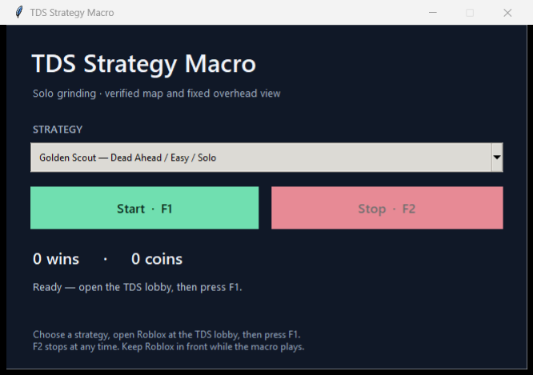

# TDS Macro

A Windows app for **Golden Scout · Dead Ahead · Survival / Easy / Solo** in Roblox Tower Defense Simulator. It selects the map, prepares an overhead view, places nine Scouts vertically along the path, and repeats successful matches with Play Again.

**[Download the Windows app](https://github.com/PracticalSwan/tds-macro/releases/latest)** · [Setup](docs/setup.md) · [Troubleshooting](docs/troubleshooting.md) · [Verification](docs/verification.md)

**Planning only — v0.3.0:** A proposed [Hardcore Gem Grind / Wretched Front implementation plan](docs/plans/2026-11-18-v0.3.0-hardcore-gem-grind-implementation.md), [reference notes](docs/plans/2026-11-18-v0.3.0-hardcore-gem-grind-references.md), and [real-game acceptance checklist](docs/plans/2026-11-18-v0.3.0-hardcore-gem-grind-live-trials.md) are available for the implementing agent. Hardcore is **not available in the currently released v0.2.4 app**.

## Start playing

1. Extract the release ZIP. Keep the entire `TDSMacro` folder together.
2. Open `TDSMacro.exe` and choose Golden Scout.
3. Open the TDS lobby with **Golden Scout in slot 1 and slots 2–5 empty**.
4. Press **F1**, then put Roblox in front during the five-second countdown.
5. Keep Roblox focused. **F2 stops**; closing the app also stops its worker. F8/Escape are additional emergency stops.

**Launch note:** Run `TDSMacro.exe` **inside the fully extracted `TDSMacro` folder**, alongside `_internal`, `assets`, `calibrations`, and `strategies`. The `.exe` by itself is not a standalone app. If it appears not to open, check **Alt+Tab** or the taskbar; a working GUI can start behind another window. Multiple locally built versions can have the same filename, so prefer the current [release ZIP](https://github.com/PracticalSwan/tds-macro/releases/latest) rather than an older `dist` copy. [Troubleshooting](docs/troubleshooting.md) covers further checks.

The app repeats successful matches and displays confirmed progress, wins and coins. **Recover game failures automatically** is enabled by default: a failed game is closed, TDS is reopened and the strategy starts fresh from the lobby. F2 cancels both play and recovery. No separate Python installation is needed.

## Required setup

| Setting | Supported configuration |
|---|---|
| System / client | Windows 11, Microsoft Store Roblox GDK |
| Roblox client area | **1920 × 991 physical pixels, 120 DPI** (125% scaling) |
| Window / language | Windowed, fully visible and foreground; English TDS and local English Windows OCR |
| TDS settings | UI Scale **Large**, vertical upgrades; [full baseline](docs/setup.md#tds-settings-baseline) |
| Game / account | Solo; VIP map selection; Golden Scout only in slot 1 |
| Strategy | Dead Ahead, Survival / Easy; nine Scouts, 44 actions |

The client area excludes title bar/borders. A 1920×1080 display is tested; a “1920×992 window” is not an equivalent measurement. Fullscreen, other sizes/DPI, macOS and mobile are unsupported. Read [setup](docs/setup.md) first.

## Verified behavior and limits

The app reads live cash, prices, tower state and results before sending each guarded action. It stops on unknown states, lost foreground, changed identity, unsupported geometry or unconfirmed purchases. Recovery never refocuses Roblox or repeats an uncertain action. **v0.2.4** verified a natural Error 278 disconnect, guarded Leave → Roblox Home → close → relaunch → stable lobby, and a subsequent 44/44-action win. A separate Error 277 recovery stopped because a foreground lobby could not be verified; automatic recovery from that case is **not** established. See [verification](docs/verification.md) for the exact evidence, release checks and unverified boundaries.

Cash/prices are read from the game; starting cash is not fixed. Tower identity uses labels and levels rather than skin portraits. **Modifier selection is deferred pending challenge unlocks.** Committed + Limitation + Hidden Enemies + Glass remains a future target requiring separate win/reward validation. This release retains the existing profile and does not configure modifiers or claim a reward boost. Other modifier combinations and skins still need live trials. UI changes may require recalibration.

Uncertain map, pose, resources or action confirmation stops the current attempt. A delayed purchase is observed without clicking again. Foreground loss immediately releases input. With recovery enabled, the same client must return naturally within five seconds, confirmed twice, before a fresh-session restart; the app never brings Roblox forward. Manual stop/pause, persistent focus loss, changed identity/geometry, setup/storage errors and the recovery limit stop the run. This unofficial project does not guarantee Roblox/TDS permission or account safety; review the [Community Standards](https://about.roblox.com/community-standards) and [exploiting guidance](https://en.help.roblox.com/hc/en-us/articles/203312450-Cheating-and-Exploiting).

## Contribute

Contributions are **suggestions and new strategies only**. Use the [issue forms](https://github.com/PracticalSwan/tds-macro/issues/new/choose); strategy PRs follow [CONTRIBUTING.md](CONTRIBUTING.md). Core implementation is owner-maintained.

[Build/development](docs/development.md) · [Strategy credit](docs/strategies.md) · [Changelog](CHANGELOG.md) · [Security](SECURITY.md) · [License/notices](NOTICE.md)
